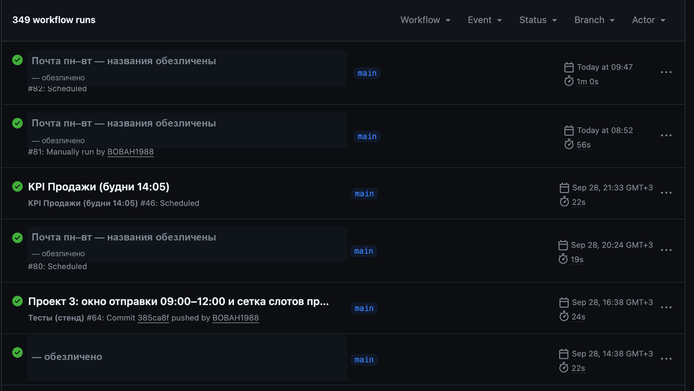

# ZOO_opt — приложение для автоматизации почтовых процессов и управления клиентами

**Стек:** Python, GitHub Actions, IMAP/SMTP, openpyxl, xls2xlsx, Firebase, Firestore, React, Vite, TypeScript, CI/CD  
**Репозиторий:** https://github.com/BOBAH1988/ZOO_opt (публичный)

## Что это

Единственный рабочий репозиторий, в котором развиваются два направления:

1. **PWA-приложение ZOO_opt** — управление клиентами, маршруты визитов, импорт из Excel, запуск почтовых процессов, KPI-отчёты. Размещается на GitHub Pages, использует Firebase Authentication и Firestore.
2. **Автоматизация почты** — скрипты (скопированы из упразднённого репозитория `mail-automation`) лежат в папке `mail-automation/` внутри `ZOO_opt`, GitHub Actions workflow для их запуска — в `.github/workflows/` этого же репозитория.

Автоматизированная обработка почты по настроенным сценариям: рассылка прайсов, пересылка заказов и счетов, ответы по дебиторке, KPI-отчёты. Работает в облаке, без включённого компьютера и без ручного запуска каждого сценария.

Система закрыла рутинный цикл B2B-опта: входящее письмо → разбор вложения → обработка Excel → ответное письмо контрагенту. Раньше эти операции выполнялись вручную, с задержками и ошибками.

Направление документов зафиксировано: прайсы **приходят от поставщиков и рассылаются клиентам**, счета **пересылаются от поставщика клиенту**, заказы и платёжки — оператору, отчёты формируются для руководства.

## Ключевые цифры

| Показатель | Значение |
|---|---|
| Проектов automatзации почты | 14 |
| Система рекомендаций к заказу | 1 (внутри ZOO_opt) |
| Проверок (стенд сценариев + pytest) | 131 сценарий + 50 pytest-тестов |
| Участия человека в штатном режиме | 0 |
| Режим работы | 24/7, по расписанию |

## Архитектура

**Диспетчер → оркестраторы → общие модули → почта / Excel**

- **Диспетчер** `run_all.py` — единая точка расписания (`JOBS`).
- **Оркестраторы** — по одному на проект; 13 из 14 — наследники общего базового класса `ProjectBase` (окна `retry_before`/`deadline`, уведомления о пропуске и ошибках, тестовый режим — в одном месте). Исключение — проект 13 «Рекомендации к заказу»: отдельный workflow по понедельникам (сборка отчёта на 26 745 позиций из прайса остатка в письме и продаж из репозитория), поэтому он помечен standalone и не входит в общий диспетчер опроса почты.
- **Общие модули:**
  - `mail_common.py` — работа с почтой (IMAP/SMTP, ретраи только транзиторных сбоев);
  - `project_base.py` — базовый класс проектов (окна, уведомления, тестовый режим);
  - `kpi_processors.py` — чистая логика KPI (разбор xlsx, ступени/начисления, письмо);
  - `price_processor.py` — обработка прайсов и файлов задолженности;
  - `send_email.py` — формирование и отправка писем, вложения;
  - `notify.py` — служебные и аварийные уведомления;
  - `constants.py` — расписание, настройки, тексты шаблонов.
- **Слой почты / Excel** — чтение входящих писем, конвертация и разбор xls/xlsx (openpyxl, xls2xlsx), отправка через SMTP.

### Надёжность и безопасность

- **Retry** — только для транзиторных сетевых сбоев; ошибки аутентификации не повторяются (защита от блокировки ящика).
- **Защита от дублей** — проверка папки «Отправленные» перед рассылкой.
- **Приватность рассылки** — BCC: получатели не видят друг друга.
- **Секреты** — учётные данные и ключи хранятся только в GitHub Secrets, в коде их нет.
- **Аварийный канал** — при сбое обработки приходит письмо «❌ Ошибка».
- **Логирование** — структурированное, с временем МСК.
- **Тестовый режим** — ручной запуск можно прогнать на себя, не затрагивая клиентов.
- **Технические нюансы IMAP:** месяц в `SEARCH` всегда передаётся английским словом — локаль не влияет на результат.
- **Задержки GitHub Actions** учтены: утренние слоты сдвинуты на 3 часа раньше, чтобы попасть в рабочее окно.

### Миграция из старого репозитория mail-automation

Исходный репозиторий `mail-automation` упразднён. Весь код (скрипты, requirements, конфиги) скопирован в папку `mail-automation/` внутри `ZOO_opt`. GitHub Actions workflow для запуска скриптов созданы в `.github/workflows/` этого же репозитория. Сервер запуска процессов (`server/index.js` / Cloudflare Worker) перенаправлен на репозиторий `ZOO_opt`.

KPI-отчёт (проект 12) теперь записывается в коллекцию `kpi_reports` в Firestore вместо отправки email и отображается на странице «KPI задачи» в приложении ZOO_opt.

## Технологии

- **Python** — бизнес-логика, оркестраторы, почтовые модули.
- **IMAP / SMTP** — приём и отправки писем, вложения, BCC-рассылки.
- **openpyxl, xls2xlsx** — чтение, конвертация и правка Excel-файлов (прайсы, дебиторка, платёжки).
- **GitHub Actions** — запуск по расписанию, без своего сервера.
- **CI/CD** — автопрогон при каждом push: ruff, pytest + coverage, mypy (4 общих модуля под строгими типами), стенд сценариев, ретраи, диспетчер.
- **pytest + стенд сценариев** — 131 сценарий поведения + 50 pytest-тестов, без выхода в сеть.
- **concurrent.futures** — параллельный запуск проектов.
- **React, TypeScript, Vite** — фронтенд PWA-приложения ZOO_opt.
- **Firebase Auth / Firestore** — аутентификация, хранение клиентов, истории запусков и KPI-отчётов.
- **GitHub Pages** — хостинг фронтенда.

## Навыки

- Проектирование архитектуры
- Автоматизация процессов
- Работа с API и почтовыми протоколами
- Тестирование
- Документирование
- Рефакторинг и оптимизация структуры проекта
- Структурирование проекта под работу с ИИ (README как носитель контекста)

## Проекты (обезличенные)

Все проекты запускаются по расписанию в GitHub Actions. Названия компаний, имена, суммы и показатели заменены обезличенными значениями. Колонка «Результат» описывает качественный эффект, а не точные цифры.

| № | Что делает | Результат |
|---|---|---|
| 1 | Приём прайса от поставщика + рассылка клиентам | 0 ручных рассылок |
| 2 | Рассылка прайса + удаление служебных строк | 0 ручных рассылок |
| 3 | Разовая рассылка готового прайса | Без ручного выбора получателей |
| 4 | Пересылка заказа оператору + классификация писем | 0 пропусков |
| 5 | Пересылка счёта поставщика клиенту | Отправка в день обращения |
| 6 | Пересылка счетов контрагенту | Отправка в день обращения |
| 7 | Анализ файла дебиторки + ответ клиенту | Ответ в тот же рабочий день |
| 8 | Пересылка счёта клиенту по расписанию | 0 пропусков |
| 9 | Массовая пересылка по списку получателей | 0 пропусков |
| 10 | Разбор файла задолженности + отчёт | Отчёт в тот же рабочий день |
| 11 | Пересылка платёжек оператору | 0 пропусков |
| 12 | KPI-отчёт по выполнению плана | Отчёт к началу рабочего дня (сохраняется в Firestore, показывается в приложении) |
| 13 | Сверка прайса с остатком и продажами — рекомендации к заказу | Отчёт собирается по понедельникам и рассылается руководителю отдела продаж и директору |
| 14 | Разовая рассылка сокращённого прайса клиенту (вместе с проектом 3) | Без ручной отправки |
| | **Итого: 14 проектов** | **24/7 без участия человека** |

## Принципы разработки

- **Модульность** — каждый проект изолирован, общая логика вынесена в переиспользуемые модули.
- **Тестируемость** — 131 сценарий + 50 pytest-тестов на заглушках IMAP/SMTP, прогон в CI при каждом push; при рефакторинге сравнивается поведение «до/после» — расхождений быть не должно.
- **Безопасность** — секреты только в GitHub Secrets, BCC-рассылки, защита от дублей, отсутствие повторов при ошибках аутентификации.
- **Документирование** — назначение и правила запуска каждого проекта описаны в README репозитория.

## Результаты

- 14 проектов работают в проде без участия человека — 24/7, по расписанию.
- Исключены ошибки ручной обработки: забытое письмо, не тот файл, дубль.
- Работает в облаке — не требует включённого компьютера.
- Масштабируется: добавление нового проекта — 30–60 минут.
- Экономия времени на рутинных операциях — оценка по совокупности всех проектов, без привязки к точным часам.

### Лог GitHub Actions

349 запусков, все успешные. Названия компаний и клиентов на скриншоте обезличены.

## Как разрабатывалось

Проекты созданы с использованием ИИ-ассистентов. Основные инструменты — **Cline** как AI coding assistant для создания и изменения кода, тестов и документации; **Perplexity** для анализа подходов, проверки решений и поиска технической информации. Дополнительно использовались DeepSeek, Claude и Kilo Code.

- ИИ-ассистент пишет и правит код, тесты и документацию;
- бизнес-логика и архитектура остаются за мной — ассистент ускоряет рутину, а не подменяет решение;
- я формулирую требования и проверяю результат на рабочих данных, отклоняя решения, которые задачу не решают;
- новые инструменты осваиваются за часы, а не за неделями.

## Контакты

- GitHub: https://github.com/BOBAH1988
- Telegram: [@Vsokolov1988](https://t.me/Vsokolov1988)

---

[← Вернуться к портфолио](README.md)
